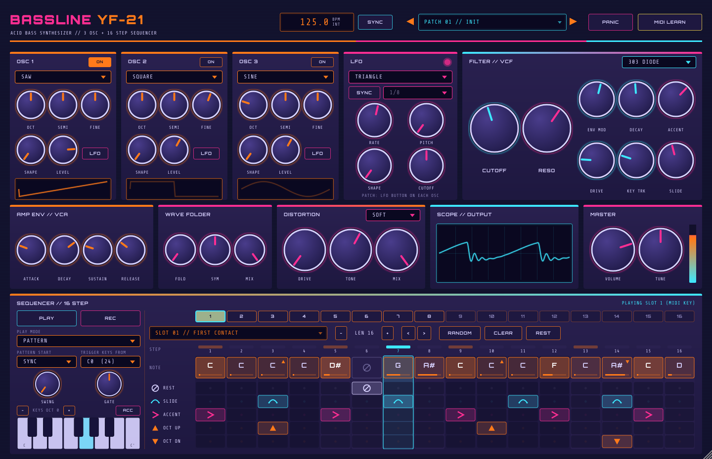

# Bassline YF-21
Acid bass synthesizer with a 16-step sequencer (JUCE, VST3 + Standalone).
Same look as [Decu6000](https://github.com/LexLongcoding/Decu6000). Free and open source - see [License](#license).

**[User manual (PDF)](docs/BasslineYF21-User-Manual.pdf)** - installing, every control, the sequencer, recording,
using it in a DAW, MIDI learn, patches and patterns, tips.

## What it is
A monophonic bass synth in the classic acid tradition - the single-oscillator, squelchy-filter,
slide-and-accent sequencer sound - with modern extras:

- **3 oscillators**, each with ON, WAVE, OCT (-2..+2), SEMI, FINE, SHAPE, LEVEL and an LFO patch button.
  Waves: SAW, SQUARE, TRIANGLE, SINE and 8 wavetables (FORMANT, ORGAN, SYNC, FOLD, BITS, PHASE,
  GLASS, HARMONIC) generated in code, band-limited, morphed with SHAPE. Each oscillator shows its waveform.
- **LFO**: 7 waves, free rate or tempo-synced divisions, patched per oscillator (pitch and shape depth)
  plus its own bipolar CUTOFF amount.
- **Filter**: CUTOFF, RESO, ENV MOD, DECAY, ACCENT (the classic five) plus DRIVE, KEY TRK and SLIDE time.
  Modes: 303 DIODE (thin, squelchy, ~18 dB), 24DB LADDER, 12DB SVF.
- **303 behaviour**: slide holds the gate and glides without retriggering the envelopes; accent is louder,
  uses the shortest filter decay, and charges an "accent sweep" so runs of accents climb.
- **AMP ENV** (attack / decay / sustain / release), **WAVE FOLDER** (fold, symmetry, mix) and
  **DISTORTION** (soft / hard / fuzz / tube / crush, with tone and mix) before the output.
- **Scope**, output meter, master volume and tune.
- **Sequencer** on the same page: 16 steps, 16 pattern slots saved with the project, length 1-16,
  swing, gate, random acid generator, shift, copy/paste slots. Each step has a note (C..C) and the
  modifiers REST, SLIDE, ACCENT, OCT UP, OCT DOWN, each with its own symbol.
- **Live record** (quantised to the nearest step) and **step record** (yellow cursor) from MIDI or the
  13-key on-screen keyboard (C to C, like the original).
- **Tempo display** (drag to change) and **SYNC** to the DAW's tempo and position.
- **MIDI learn** for every knob, button and menu (MIDI LEARN in the header, or right-click any control).
- **Patches** (sound) and **patterns** (notes) each have factory sets and your own saved files.

## Playing it from a DAW
**PLAY MODE** (sequencer panel) decides what incoming MIDI notes do:

| Mode | Low keys (TRIGGER KEYS, default C0-D#1) | Other keys |
|---|---|---|
| **PATTERN** | Hold a key to play slot 1-16, locked to the DAW. Release (or stop the DAW) to stop. | While a slot is held: transpose it relative to C3 (E3 = +4, A2 = -3). With no slot held: play the synth. |
| **FREE** | Play the synth | Play the synth |

Playing the synth directly (FREE mode, or PATTERN mode with no slot held) behaves like the hardware:
overlapping notes **slide**, velocity 100+ is an **accent**. So a bassline drawn in the piano roll gets
slides and accents too.

- **PATTERN START**: SYNC plays the step under the DAW's position (always in time); RETRIG starts the
  slot from step 1 on the next 16th.
- **TRIGGER KEYS FROM**: slot 1's key - any note from C-2 (MIDI 0, the lowest there is) to C3, default C0;
  slots 2-16 are the keys above it. Move it down if you also want to play low bass notes in PATTERN mode.
- **PANIC** (header): all notes off - stops the sequencer and silences the synth immediately.
- The **PLAY** button plays the selected slot inside the plugin (for auditioning and recording).
  With SYNC on and the DAW playing, it follows the DAW's position.

## Recording patterns
1. Click a slot (1-16) and press **REC**.
2. **Step record** (stopped): play notes from your keyboard or the on-screen keys; each one fills the
   step under the yellow cursor and moves on. Overlap notes (or drag across the on-screen keys) for a
   slide, play hard (or press ACC) for an accent, **REST** for a rest. Click a step number to move the cursor.
3. **Live record** (PLAY on): play along; notes snap to the nearest step.
4. Edit anything on the grid: drag a note up/down (or scroll), click modifier cells (drag to paint).
5. Save it to the library from the pattern LCD menu; the 16 slots are saved with your DAW project anyway.

## Getting builds
### Easiest: let GitHub build it (Windows + Linux, no compiler needed)
Push this folder (including the hidden `.github` folder) to a GitHub repository. On the **Actions** tab a
"Build Bassline YF-21" run starts by itself (~10 minutes). Download **BasslineYF21-Windows** and/or
**BasslineYF21-Linux** from the run's *Artifacts*. Each zip has an INSTALL file.

To publish a release: Actions -> *Build Bassline YF-21* -> *Run workflow*, enter a version such as `v0.1.0`.

### Build it yourself
Requires CMake 3.22+, a C++17 compiler, and internet access (JUCE 8.0.4 is fetched on first configure).

**Windows** - Visual Studio 2022 or newer ("Desktop development with C++") and CMake:

    cmake -B build -A x64
    cmake --build build --config Release

**Linux** (Debian/Ubuntu package names):

    sudo apt install build-essential cmake git libasound2-dev libjack-jackd2-dev \
        libfreetype6-dev libfontconfig1-dev libx11-dev libxcomposite-dev libxcursor-dev \
        libxext-dev libxinerama-dev libxrandr-dev libxrender-dev libgl1-mesa-dev
    cmake -B build -DCMAKE_BUILD_TYPE=Release
    cmake --build build --parallel

Output: `build/BasslineYF21_artefacts/Release/VST3/Bassline YF-21.vst3` and `.../Standalone/`.

### User manual
`docs/BasslineYF21-User-Manual.pdf` is generated by `python3 docs/manual/make_manual.py` (needs `pip install reportlab`).
Control ranges, defaults and menu choices are read from `Source/Parameters.h`; screenshots come from `docs/images`
(made by `YF21Tests`). Re-run it after changing controls.

### Tests
- `Tests/voice_render_test.cpp` - DSP only, no JUCE: renders the voice through filter modes, waves and
  effects to WAV and checks levels. `g++ -std=c++17 -O2 -ISource Tests/voice_render_test.cpp`
- `-DYF21_BUILD_TESTS=ON` builds `YF21Tests` (51 checks: trigger keys, stuck-note cases, panic, transpose, FREE mode slides,
  SYNC/RETRIG starts, host tempo, step + live record, 303 slide gating, CC learn, state round trip,
  every factory patch, editor screenshots) and `YF21HostTest` (loads the built .vst3 like a DAW).

## License
Bassline YF-21 is free software: GNU Affero General Public License v3.0 or later (see `LICENSE`).
JUCE is used under its AGPLv3 option. Fonts: SIL Open Font License (see `Resources/Fonts`).
See `THIRD-PARTY-NOTICES.md`.

Not affiliated with Roland or Korg. "VST" is a trademark of Steinberg Media Technologies GmbH.
